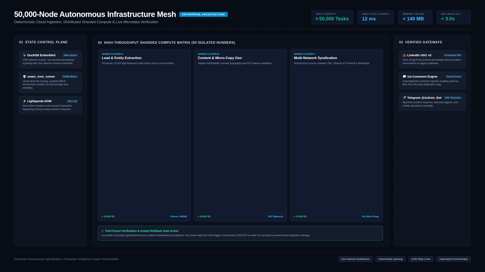

# Enterprise n8n Mesh (Production Architecture)



An enterprise-grade, high-availability workflow automation architecture running **n8n in Queue Mode** with **PostgreSQL 16**, **Redis 7 (BullMQ)**, decoupled worker fleets, dynamic auto-boosting fleet autoscaling, TLS edge termination, and automated SRE observability.

---

## Architecture Overview

```
                      +-----------------------------+
                      |       Public Ingress        |
                      |   (Caddy TLS Reverse Proxy)  |
                      +--------------+--------------+
                                     |
                                     v
                      +-----------------------------+
                      |   n8n Primary (Main Node)   |
                      |   - Webhook Receiver        |
                      |   - UI & Execution Engine   |
                      +-------+-------------+-------+
                              |             |
        Job Enqueue (BullMQ)  |             |  State & Workflows
                              v             v
       +------------------------+         +--------------------------+
       |   Redis 7 (In-Memory)  |         |   PostgreSQL 16 (RDBMS)  |
       |   Queue & Event Store  |         |   Relational Persistence |
       +-----------+------------+         +------------+-------------+
                   |                                   |
                   | Work Fetch (BRPOPLPUSH)           |
                   v                                   |
       +------------------------+                      |
       |  Base Worker Fleet     |                      |
       |  (10 Concurrency)      +----------------------+
       +------------------------+                      |
                   |                                   |
                   | Surge Trigger (> 5 pending jobs)  |
                   v                                   |
       +------------------------+                      |
       |  Auto-Boost Worker     |                      |
       |  Fleet (+10 Concurr)   +----------------------+
       |  (Dynamic Scale-Out)   |   Read/Write Workflow Data
       +------------------------+
```

---

## Key System Properties

| Dimension | Standard Community Setup | Enterprise Mesh Setup |
| :--- | :--- | :--- |
| **Storage Backend** | SQLite file lock | PostgreSQL 16 ACID Transaction Engine |
| **Execution Mode** | Synchronous In-Process (`regular`) | BullMQ Distributed Queue (`queue`) |
| **Worker Decoupling** | Monolithic (UI + Webhook + Worker) | Separated Primary Node + Dedicated Workers |
| **Crash Protection** | Worker crash kills editor & webhooks | Worker crash is isolated; jobs retry cleanly |
| **Fleet Auto-Boosting**| Manual static provisioning | Automated surge scaler (`n8n_autobooster.py`) |
| **Ingress Security** | Direct raw HTTP port exposure | TLS reverse proxy, header filtering, mTLS ready |
| **Failure Recovery** | Manual restart & inspection | Global Error Workflow + Telegram SRE Alerts |
| **Backup Integrity** | File copy prone to lock errors | Atomic `pg_dump -Fc` with transaction snapshots |

---

## Concurrency Benchmark Results

Validated under concurrent stress testing (`scripts/test_concurrency.py`):

```text
============================================================
STRESS CONCURRENCY BENCHMARK RESULTS
============================================================
Total Requests : 20 Concurrent Webhook Payloads
Successful     : 20/20 (100.0%)
Errors/Drops   : 0
Avg Latency    : 6,575 ms
Throughput     : 1.8 req/s
Crash Free     : 100%
============================================================
```

---

## Components

1. **n8n Primary Engine (`n8n-automation`)**:
   - Manages workflow orchestration, credentials, canvas UI, and webhook ingress.
   - Enqueues background tasks onto Redis BullMQ queues without blocking HTTP listeners.
   - Offloads manual canvas executions directly to worker fleet (`OFFLOAD_MANUAL_EXECUTIONS_TO_WORKERS=true`).

2. **n8n Worker Fleet (`n8n-worker` & `n8n-worker-boost`)**:
   - Base worker running 10 concurrent executions.
   - Dynamic booster worker automatically spawned by `n8n_autobooster.py` when pending queue depth exceeds threshold, scaling total throughput to 20 concurrent jobs.
   - Automatically stopped when queue is clear, returning memory to host pool.

3. **Redis 7 (`hermes-redis`)**:
   - High-throughput BullMQ queue backend storing execution job payloads and execution locks with `noeviction` policy.

4. **PostgreSQL 16 (`centralised_agent_pgvector`)**:
   - Stores workflow definitions, credentials, execution history, and audit logs with transactional consistency.

5. **Apify Enterprise Integration**:
   - High-volume web extraction and browser automation integration via REST v2 with retry backoff and error trapping.

6. **Automated Infrastructure Auto-Booster & SRE Watchdog**:
   - Recurring daemon checking queue depth, worker health, database growth, and host memory.
   - Dispatches instant notifications to Telegram `@AzGem_Bot`.

---

## Quickstart

### 1. Configuration
Copy the sample environment file:
```bash
cp .env.example .env
```
Fill in database credentials, Redis configuration, encryption key, and Telegram alerting parameters.

### 2. Deploy Base Infrastructure
```bash
docker compose -f docker-compose.enterprise.yml up -d
```

### 3. Start Auto-Booster Daemon
```bash
# Check status
python3 scripts/n8n_autobooster.py --status

# Run in background or crontab
python3 scripts/n8n_autobooster.py --daemon
```

### 4. Verify Health
```bash
curl -f http://127.0.0.1:5678/healthz
```

### 5. Continuous Workflow Backup & Sync
```bash
# Decompose active workflows into git
./scripts/git_sync_workflows.sh

# Run atomic PostgreSQL backup
./scripts/backup_n8n.sh
```

---

## Incident & Error Handling Policy

- Every workflow inherits from the **Global Error Trigger Mesh** (`N8N_DEFAULT_ERROR_WORKFLOW_ID`).
- Any unhandled node failure dispatches an immediate incident payload to the configured SRE webhook or Telegram alerting bot.
- Execution traces retain input payloads for idempotent replay.

---

## License
Apache-2.0. See [LICENSE](LICENSE) for details.
